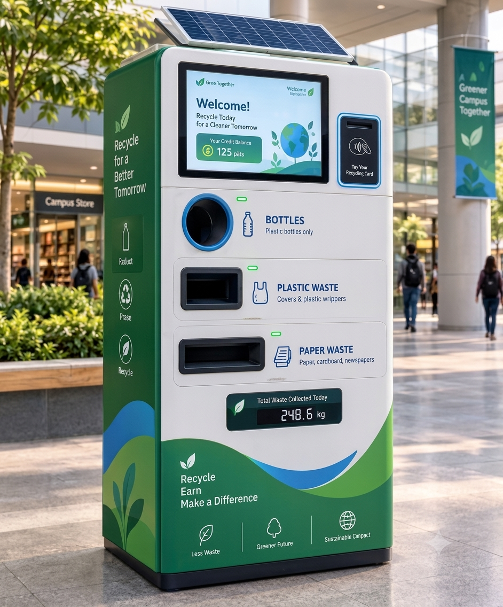
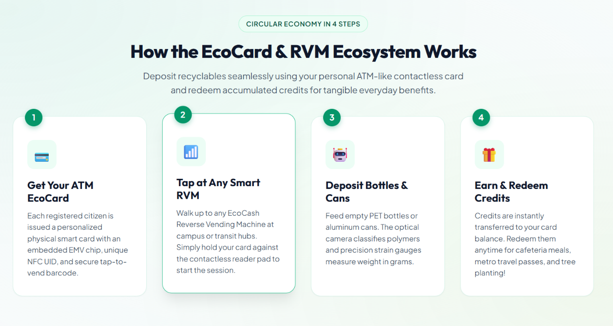

# EcoCash – A Reverse Vending Machine with Digital Rewards
### An Automated IoT-Enabled Reverse Vending Machine and Contactless Smart Card Ecosystem

EcoCash is a recycling incentive platform concept that combines a smart reverse vending machine (RVM), a contactless NFC EcoCard and a web-based rewards ledger. It is designed to make recycling more convenient by identifying and weighing deposited waste, awarding credits and allowing users to redeem those credits for practical rewards.

**Live web prototype:** https://ecocash-vert.vercel.app/

> **Project status:** The responsive web prototype is implemented and deployed. Physical RVM hardware integration—including NFC reading, camera-based waste identification, load-cell weighing and automated sorting—is planned as the next phase. The hardware capabilities described below are proposed system functionality, not claims that the physical machine is already complete.

---

## Project Visuals

### EcoCash Smart Reverse Vending Machine

### EcoCard & RVM Ecosystem Workflow

---

## Table of contents
- [Problem](#problem)
- [Proposed solution](#proposed-solution)
- [Key features](#key-features)
- [How it works](#how-it-works)
- [Credit calculation](#credit-calculation)
- [System architecture](#system-architecture)
- [Technology stack](#technology-stack)
- [Implementation status](#implementation-status)
- [Future enhancements](#future-enhancements)
- [Research references](#research-references)

## Problem

Recycling participation can be reduced by inconvenient waste sorting and rewards that are delayed or difficult to redeem. Many existing reverse vending systems focus on beverage containers and may rely on barcodes, manual intervention or smartphone applications. There is also a need to address multiple waste streams, reliable identification and protection against fraudulent reward claims.

## Proposed solution

EcoCash proposes an automated, app-free recycling experience using a contactless EcoCard. A registered user taps their card at a kiosk, deposits waste into the appropriate slot, and receives credits based on the accepted material and its weight. Transactions are recorded in a central web ledger, while bin-fill information can be monitored through a dashboard.

The proposed machine separates four waste categories:
- Bottles
- Plastic waste
- Biodegradable waste / paper
- Electronic waste (e-waste)

Optical classification and load-cell measurements are intended to work together to identify and weigh deposits. Contaminated or wet items can be rejected before credits are awarded.

## Key features

The current web prototype models the following features:

- **User dashboard:** Overview of the user's EcoCash activity and credits.
- **EcoCard hub:** Card management, including freeze-card functionality and a daily credit limit.
- **RVM kiosk simulator:** Demonstrates the waste-deposit and credit-awarding workflow.
- **Waste history ledger:** Displays recorded deposit transactions.
- **Credit calculator:** Calculates credits using the selected material rate and deposited weight.
- **Rewards catalogue:** Shows redeemable reward options.
- **Leaderboard:** Displays user rankings.
- **Bin-fill status:** Presents machine bin status in the prototype.

The proposed hardware system additionally includes NFC card authentication, camera and load-cell sensing, automated waste routing and cloud synchronization.

## How it works

1. **Register:** A user account is created and associated with a unique EcoCard ID.
2. **Tap:** The user taps the NFC EcoCard at the RVM.
3. **Authenticate:** The system checks the card registration, card status and daily credit limit.
4. **Deposit:** The user places an item in the matching waste slot.
5. **Identify and weigh:** The proposed sensing system uses a camera and load cell to assess the item.
6. **Validate:** Contaminated, wet or unaccepted items are rejected.
7. **Calculate credits:** Accepted waste earns credits according to its weight and material-specific rate.
8. **Record and sync:** The transaction is added to the ledger and synchronized with the cloud.
9. **Redeem:** Users can redeem accumulated credits for available rewards.

## Credit calculation

The prototype uses a material-wise rate engine:

**Credits = Weight (kg) × Material rate (credits/kg)**

| Material | Rate |
|---|---:|
| PET bottles | 100 credits/kg |
| Aluminium cans | 120 credits/kg |
| Rigid plastics (HDPE/PP) | 75 credits/kg |
| Carry bags | 50 credits/kg |

These are the rates specified for the current prototype.

## System architecture

The proposed system has three main parts:

1. **User and EcoCard:** A registered user uses an NFC-enabled card to start a session.
2. **Smart RVM:** An ESP32 or Raspberry Pi controller connects to an NFC reader, camera, load cell, bin-level sensor and diverter motors. The machine is designed around four waste collection slots.
3. **Cloud platform:** A REST API and database support the web ledger, dashboard, transaction history and rewards.

The prototype currently demonstrates the web-side experience. Integration with the physical controller and sensors is planned.

## Technology stack

### Implemented in the web prototype
- HTML5
- CSS3
- JavaScript
- Vercel deployment

### Proposed for hardware and intelligent sorting
- ESP32 or Raspberry Pi
- NFC / RFID reader (13.56 MHz)
- Camera module
- Load cell with HX711 amplifier
- Bin-level sensor
- Diverter motors
- Python, OpenCV and TensorFlow for waste classification
- Arduino or MicroPython firmware

### Proposed cloud communication and security
- REST API
- HTTP or MQTT communication
- Database-backed transaction ledger
- Unique card IDs
- One-time session tokens
- Daily credit limits and duplicate/replay checks

## Implementation status

| Component | Status |
|---|---|
| Responsive web application | Implemented |
| User dashboard and EcoCard hub | Modelled in prototype |
| RVM kiosk simulator | Implemented in prototype |
| Waste history and credit calculator | Implemented in prototype |
| Rewards catalogue and leaderboard | Modelled in prototype |
| Web deployment | Live on Vercel |
| Physical NFC card reading | Planned |
| Camera-based waste classification | Planned |
| Load-cell integration and automated sorting | Planned |
| Hardware-to-cloud synchronization | Planned |

## Future enhancements

- Train a deep-learning classifier using a larger, locally collected waste dataset.
- Run edge AI on an ESP32 or Raspberry Pi for on-device sorting.
- Add a mobile application and QR option alongside the EcoCard.
- Integrate with government transit and civic reward systems and partner-shop billing.
- Explore solar-powered kiosks, remote monitoring and predictive bin collection.

## Research references

The project literature survey refers to the following works:

1. Marzuki et al. (2025), *Bit-Tech*, 8(2). — Base paper.
2. Sinaga and Irawan (2020), *Telkomnika*, 18(4).
3. Nizar et al. (2020), Telkom University Open Library Publications.
4. Rahman et al. (2020), *J. Tiarsie*, 17(4).
5. Al Duhayyim et al. (2022), *Sustainability* (MDPI).
6. Bijak et al. (2022), *J. Pengemb. Teknol. Inf. dan Ilmu Komput.*, 6(6).

---

*EcoCash aims to make recycling more accessible by connecting responsible waste disposal with transparent, practical incentives.*

---

## Know About Me

I am an undergraduate student pursuing a B.E. in Artificial Intelligence and Machine Learning. I enjoy building practical projects, exploring new technologies, and applying programming and problem-solving skills to real-world challenges.
